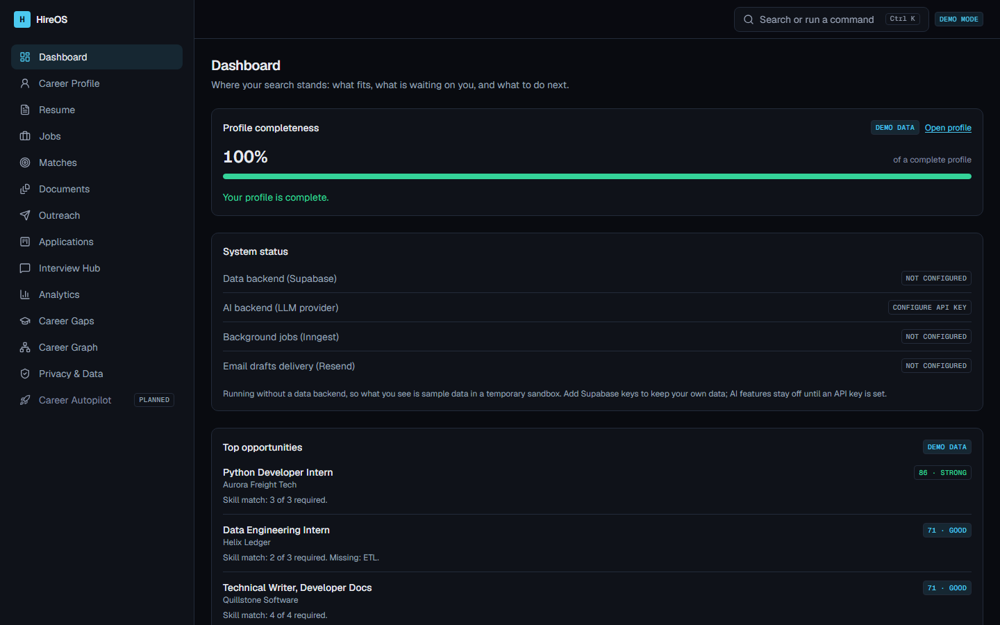
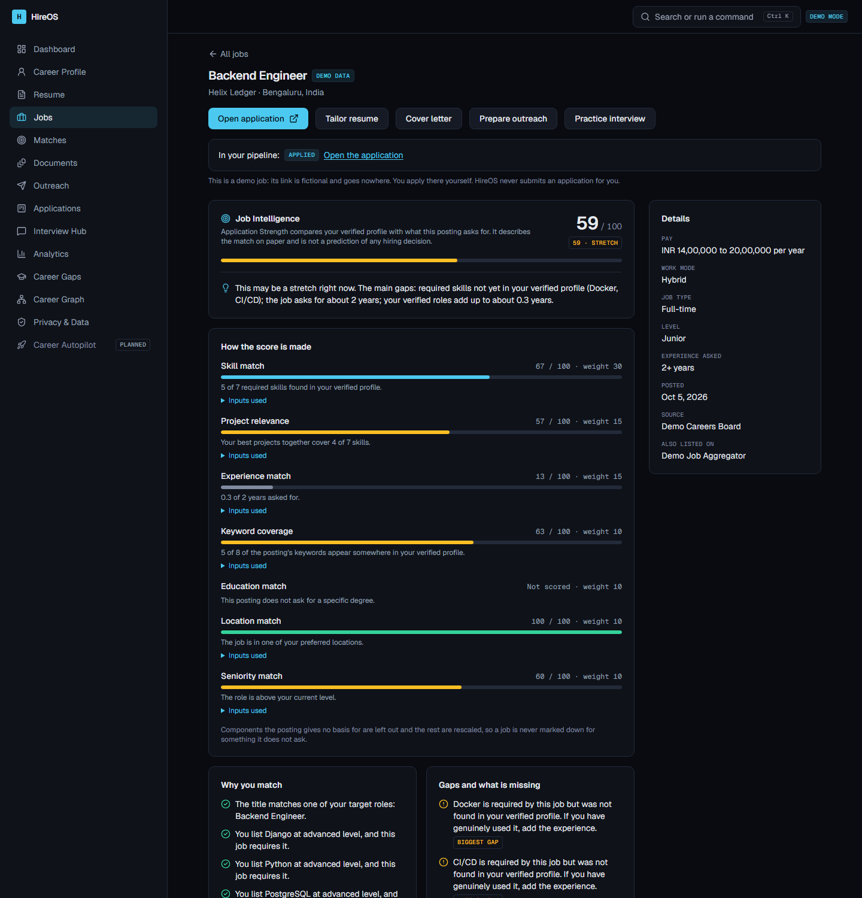
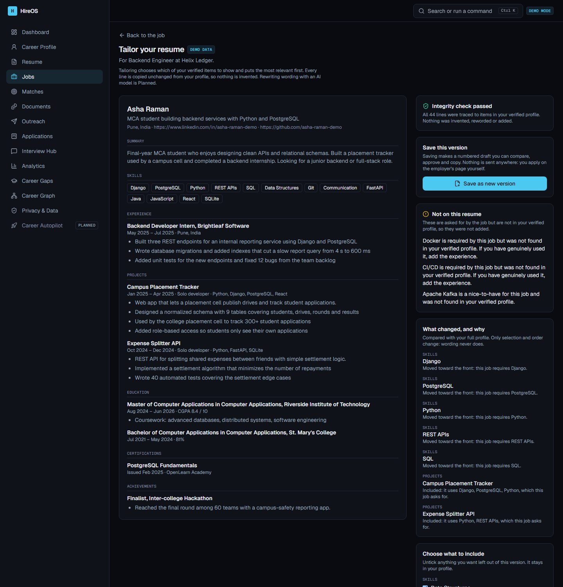

# HireOS

**A job-search workspace that shows its evidence.** HireOS helps you find roles that fit, see
exactly why, tailor your materials without inventing anything, and keep every application,
interview and follow-up in one place. It prepares and never submits: nothing is sent to an
employer, a recruiter or LinkedIn on your behalf.



**Live demo:** https://hireos-beryl.vercel.app (demo mode: a fictional candidate and sample jobs; nothing you do there is stored beyond a temporary sandbox).

> **Status.** All fifteen build phases are done. It runs with no keys in a clearly labelled
> demo mode (a fictional candidate and 41 fictional jobs), and against a real Supabase project
> when you add keys. There is **no AI model in the loop yet**: scoring, tailoring, drafting and
> interview feedback are deterministic, rule-based code, and the features that would use a
> language model are marked *Planned*. See [Honest limits](#honest-limits).

## What it does

| Area | What you get |
|---|---|
| **Career profile** | Skills, projects, roles, education, certifications, goals. Items from a resume arrive *unconfirmed*; only what you confirm counts anywhere else. |
| **Resume upload** | PDF or DOCX, parsed on the server into proposals, with a Resume Health score and a view of what a tracking system would read. |
| **Jobs** | Browse and search a catalogue, or paste a posting. Job text is cleaned and treated as data. |
| **Application Strength** | A 0 to 100 score per job with a seven-part breakdown and the inputs behind each part. It is a comparison of your verified profile with a posting, never a prediction of being hired. |
| **Tailored resume and cover letter** | Chooses and orders your verified items for a job. Wording is copied unchanged. An independent verifier re-checks every line against your profile before a version can be approved. |
| **Outreach assistant** | Drafts connection notes and emails from true facts, for you to copy and send yourself. No automation. |
| **Applications** | A pipeline board with allowed status moves, history that cannot be rewritten, notes and follow-up reminders. |
| **Interview hub** | Rounds, a prep checklist, and practice sessions with rule-based feedback that flags claims your profile does not support. |
| **Analytics and gaps** | A funnel, hedged observations ("may have", "likely contributing"), and a what-if for which skill would lift your matches most. |
| **Career graph** | Your skills, projects, jobs and outcomes as a connected picture, with a plain list alternative. |
| **Privacy and data** | Download everything as JSON, turn on two-step sign-in with an authenticator app, sign out everywhere, delete the account and its files. |

<table>
  <tr>
    <td></td>
    <td></td>
  </tr>
  <tr>
    <td align="center">Every score part shows its inputs, reasons and gaps</td>
    <td align="center">Tailoring selects and orders; an independent check traces every line</td>
  </tr>
</table>

More: [matches](docs/screenshots/matches.png), [applications](docs/screenshots/applications.png),
[interviews](docs/screenshots/interviews.png), [analytics](docs/screenshots/analytics.png),
[gaps](docs/screenshots/gaps.png), [graph](docs/screenshots/graph.png),
[privacy](docs/screenshots/privacy.png), [phone width](docs/screenshots/dashboard-mobile.png).

## Principles

These are enforced in code and tests, not just stated.

1. **Application Strength, never "hiring probability".** Deterministic, with its evidence shown.
2. **Integrity.** Nothing is invented. Every generated line carries a reference to a verified
   profile item, and a separate verifier blocks anything unsupported.
3. **Human in the loop.** HireOS prepares; you review, copy and apply on the employer's own page.
4. **No LinkedIn automation.** Notes are generated for you to copy. There is no scraping, no bot.
5. **Posting and resume text is untrusted data.** It is cleaned, rendered as text, and tested
   with hostile input.
6. **Every recommendation says why**, with evidence from your data and hedged wording.
7. **Honest by default.** Without keys the app says "demo". Unbuilt features say "Planned".

## Run it

Requires Node 22.

```bash
npm install
npm run dev
```

Open http://localhost:3000. With no environment variables set, HireOS runs in demo mode: a
fictional candidate, sample jobs, a temporary per-visitor sandbox, and a "Demo data" label
wherever it applies.

### With your own data (Supabase)

HireOS uses Supabase for accounts, the database and private file storage. The step-by-step
guide, including a local Docker route that needs no cloud account, is in
[SUPABASE_SETUP.md](SUPABASE_SETUP.md). In short: create a project, put the three keys in
`.env.local`, apply the 15 migrations, then `npm run supabase:check`.

## Commands

| Command | Purpose |
|---|---|
| `npm run dev` / `build` / `start` | Develop, build, serve a production build |
| `npm run check` | Typecheck, lint, format check, unit and database tests |
| `npm run test:e2e` | Browser tests against a production build (desktop, phone, auth-enabled) |
| `npm run test:live` | Store classes against a real local Supabase (needs Docker) |
| `npm run supabase:check` | Verify a Supabase project against what HireOS expects |
| `npm run supabase:bundle` | Join the migrations into one file for the SQL editor |
| `npm run screenshots` | Re-capture the README images from a running demo server |

See [TESTING.md](TESTING.md) for what each layer proves and what is not covered.

## How it is built

Next.js 16 (App Router), React 19, TypeScript in strict mode, Tailwind 4, Zod 4, Supabase
(Postgres, Auth, Storage, Row Level Security). Vitest, PGlite and Playwright for tests.

```
app/        routes and layouts           features/   UI and actions per feature
components/ shared UI                    services/   pure, deterministic domain logic
db/         stores: memory + Supabase    lib/        schemas, types, security helpers
supabase/   migrations and seed          tests/      unit, db, e2e, live
```

- **Two stores per feature** behind one interface: an in-memory sandbox for demo mode and a
  Supabase implementation that runs as the signed-in user, so Row Level Security decides what
  each query can see.
- **Deterministic core.** Matching, tailoring, the integrity verifier, outreach drafts,
  interview feedback, analytics and the graph layout are plain functions of stored data.
- **Security.** A nonce-based Content Security Policy and fixed headers, shared rate limits,
  per-person caps on every write, same-origin checks, validation on every input, and a
  database that refuses what the app should never do (history rewrites, illegal status moves,
  cross-account reads). Details in [SECURITY.md](SECURITY.md).

## Project documents

[PRODUCT_SPEC](PRODUCT_SPEC.md) · [ARCHITECTURE](ARCHITECTURE.md) · [DATABASE](DATABASE.md) ·
[AI_ARCHITECTURE](AI_ARCHITECTURE.md) · [SECURITY](SECURITY.md) · [TESTING](TESTING.md) ·
[ROADMAP](ROADMAP.md) (status of every phase and every known issue) ·
[SUPABASE_SETUP](SUPABASE_SETUP.md)

## Honest limits

- **No language model is called.** The provider interface exists and is documented, but
  AI-written wording and AI interview coaching are *Planned*. Everything described above works
  without one.
- **No live job feed.** Jobs are a fictional catalogue plus what you paste. Pulling postings
  from a third-party source needs a permitted integration, which is not built.
- **Scores are uncalibrated.** The weights are reasoned, not fitted to outcomes. Treat the
  number as a way to compare roles and read the reasons, not as a verdict.
- **Supabase is verified locally, not on a hosted project.** A live suite runs every store as
  two real accounts against a local Supabase stack and passes. Email confirmation and password
  reset, and anything on a hosted project, have not been exercised.
- **The hosted demo keeps each visitor's sandbox in server memory.** It is deployed on serverless hosting with no database, so your edits last only while the server instance that holds them stays alive; a restart or a request served by another instance can reset them. It is for looking around, not for keeping data. Run it with Supabase to keep your own.
- **Not built:** OAuth providers, passkeys or SMS codes, recovery codes for two-step sign-in, email delivery, background workers, PDF or
  DOCX export, and the Career Autopilot. The full list is in [ROADMAP.md](ROADMAP.md).

## Author

Built by **Kaushik** as a portfolio project.

Released under the [MIT License](LICENSE).
